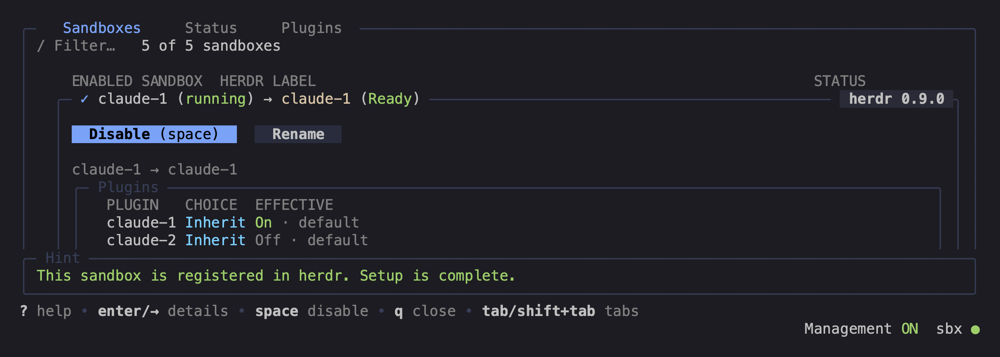
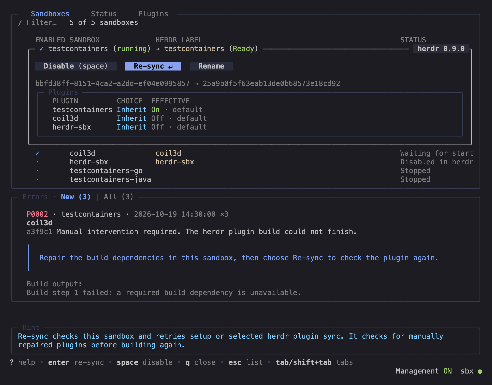
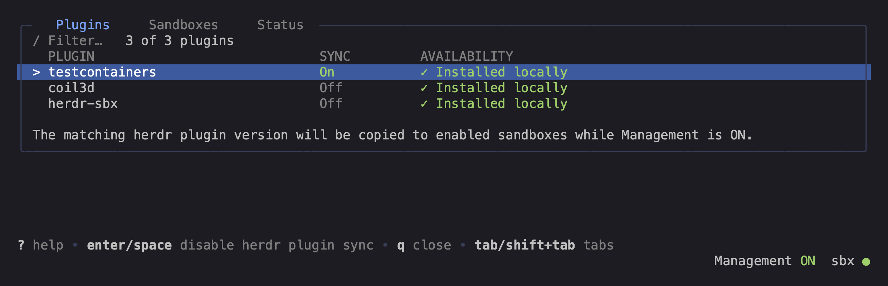
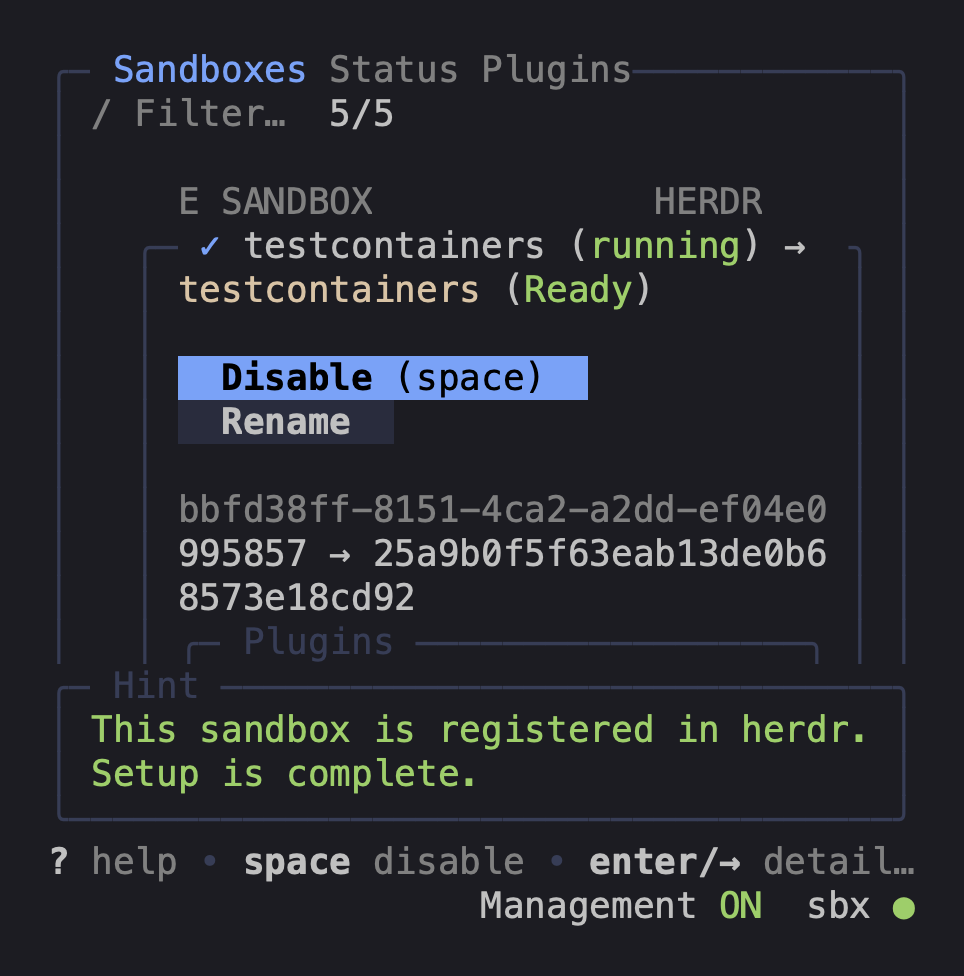

# herdr-sbx

Connect local [Docker Sandboxes](https://docs.docker.com/ai/sandboxes/) to [Herdr](https://github.com/herdrdev/herdr) over SSH.
The plugin registers running sandboxes as Herdr machines named `sbx · <sandbox-name>`.

- Herdr detects and tracks the agents it supports inside connected sandboxes.
- With Management ON, the plugin automatically installs missing Herdr and creates project workspaces in running enabled sandboxes.
- Use Fix herdr to update or repair Herdr inside a sandbox over SSH.
- Select local Herdr plugins to sync over SSH with their shortcuts.
  Guest plugin sync starts Off.

Sandbox table:



## Quick start

### Requirements

- A macOS or Linux host.
- Herdr 0.9.1 or later, `sbx` 0.45.1 or later, and OpenSSH.
- [mise](https://mise.jdx.dev/) and Git, with `mise` and `git` available on the host's `PATH`.

Start the sandbox daemon and sign in through Docker Sandboxes before using the plugin.
Configure sandbox SSH with `sbx setup ssh`.

### 1. Install

If you already use a local checkout, follow the [switching instructions](docs/reference.md#local-checkout) first.
For development, use the [local checkout route](docs/reference.md#local-checkout).
Herdr downloads the plugin and uses mise to trust its configuration, install pinned Go, and build:

```sh
herdr plugin install lanwen/herdr-sbx
```

Review and approve the installation prompt.
Herdr enables the installed plugin.

### 2. Open the sandbox manager

From a terminal inside local Herdr, open the sandbox manager:

```sh
herdr plugin action invoke open-status --plugin lanwen.herdr-sbx
```

The first opening starts Management automatically, and closing the manager leaves it running.
Management follows sandbox changes in the background while it is ON.

### 3. Find your first sandbox

Use a running sandbox for your first connection.
Newly discovered running sandboxes appear in Herdr as `sbx · <sandbox-name>` once setup completes.
Wait for the sandbox status to show Ready in the manager.

Existing Disabled choices stay Disabled.
For a running Disabled sandbox, select Enable in the manager.
For a stopped sandbox without an entry, start it independently before selecting Enable.

## Keyboard shortcut (optional)

To open the popup with prefix, then Ctrl+s, add this [keybinding](https://herdr.dev/docs/configuration/#custom-command-keybindings) to `~/.config/herdr/config.toml`.

```toml
[[keys.command]]
key = "prefix+ctrl+s"
type = "plugin_action"
command = "lanwen.herdr-sbx.open-status"
description = "Docker Sandboxes"
```

Run `herdr server reload-config` from a terminal inside Herdr to apply the change.
Press your configured prefix, then Ctrl+s, to open the popup.

## Manage sandboxes

Use the table to enable or disable sandboxes, rename herdr labels, and select synchronized herdr plugins.
Use the Management control to turn automatic work ON or OFF.
Turning Management OFF does not disable existing herdr connections.

Disabling a sandbox keeps its herdr entry and label.
After it is disabled in herdr, you can remove the entry separately.
An explicit Enable, Disable, or Rename action remains available while Management is OFF.
See the [command reference](docs/reference.md#commands-and-panel) for CLI status and daemon controls.

## Screenshots

Sandbox details and recovery actions:



Herdr plugin defaults:



Compact layout:



## Upgrade

Open the sandbox manager, set Management to OFF, and wait until cancellation settles.
Then disable the plugin from another local Herdr terminal:

```sh
herdr plugin disable lanwen.herdr-sbx
```

Reinstall from GitHub:

```sh
herdr plugin install lanwen/herdr-sbx
```

Close and reopen the manager to load the new version, then accept the Start prompt or set Management to ON.
The upgrade keeps herdr plugin state and verified machine entries.

## How it works

The daemon follows sandbox events and scans again every 30 seconds.
It downloads missing Herdr binaries on the host, compares their checksums, and copies them over SSH.
Stopped sandboxes keep their machine entries.
A stopped sandbox without an entry stays Disabled quietly.
Start that sandbox independently before enabling it in the manager.
If an entry already exists, Enable enables it in Herdr even while the sandbox is stopped.
Herdr may then connect and start it; keep the entry Disabled to prevent future connections.
Management removes an entry only after confirming its sandbox was deleted, including a disabled entry; it never removes entries automatically while OFF.

The plugin reports registration failures through Herdr notifications.
It tries to resolve version differences without stopping active panes.
Guest plugins start disabled and require an explicit selection.

See [Herdr plugins](docs/tui/plugins.md) for synchronization choices and the [reference](docs/reference.md) for commands, recovery, code navigation, and tests.
The project uses the [MIT license](LICENSE).
