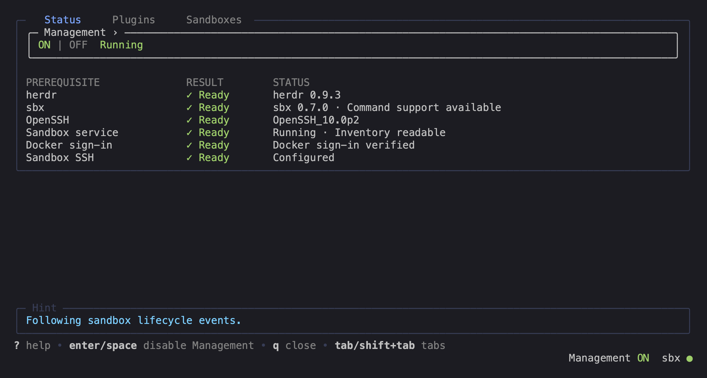
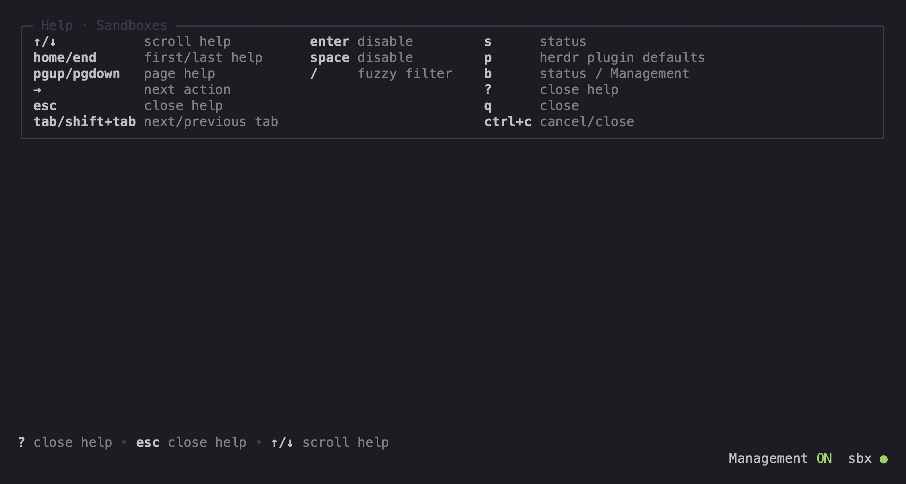

# Interactive sandbox manager examples

The [interface specification](tui-spec.md) defines shared interactions and links to each feature's behavior.
These screenshots illustrate that specification; fixture values are examples.
For capture, review, and publication, follow the [development workflow](development-workflow.md#visual-artifacts).

## Sandboxes

## Status

## Herdr plugins

## Help and compact layout

